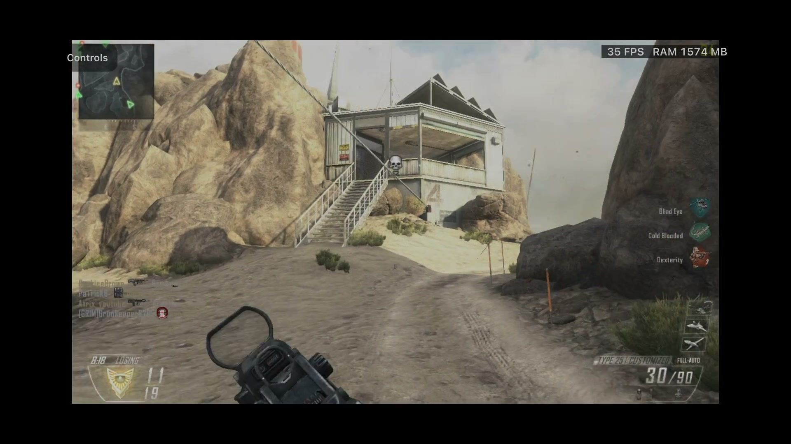
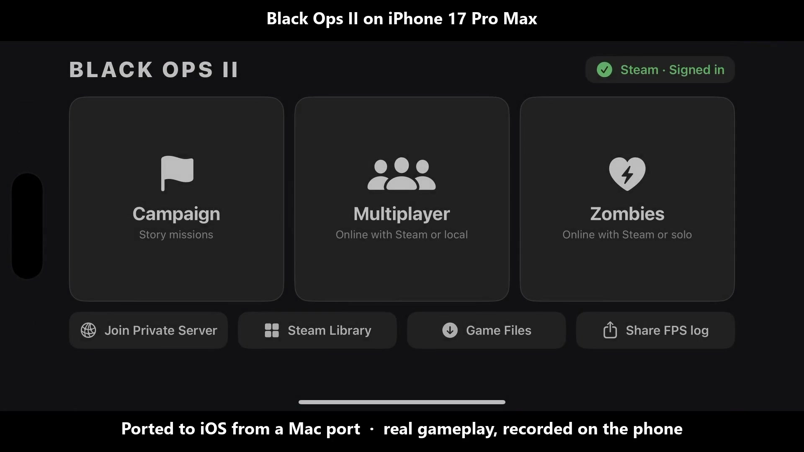
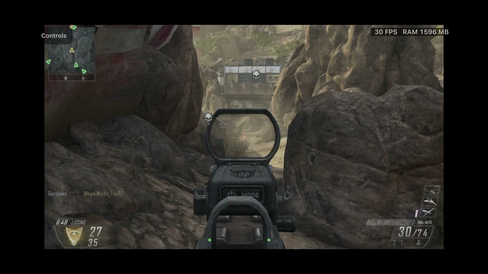

<div align="center">

# bo2-ios

**Call of Duty: Black Ops II on an iPhone, as native ARM64 code.**<br>
The statically recompiled game from [bo2-mac](https://github.com/adrbn/bo2-mac), carried to iOS: a UIKit launcher, a Metal surface, touch controls, native Steam sign-in and online multiplayer, built from your own Steam copy.

<a href="#install">Install</a> · <a href="#results">Results</a> · <a href="#how-it-works">How it works</a> · <a href="#limits">Limits</a> · <a href="#roadmap">Roadmap</a>


<sub>[Abstract](#abstract) · [Controls](#controls) · [Repository](#repository) · [Legal](#legal)</sub><br>
<sub>Experimental, updated 2026-11-15 · tried on one iPhone 17 Pro Max and the iOS 26 simulator</sub>

</div>

<p align="center"><br>
<sub>Multiplayer on an iPhone 17 Pro Max. Frame from the supplied phone recording, at 00:52.5.</sub></p>

> [!IMPORTANT]
> **This repository contains no game file and no translated game code.** It holds the launcher, the iOS glue and the
> packaging tools. The game's code ends up inside the app you build, so nobody can hand you a ready-made one: each
> player builds their own from their own Steam copy, and it may not be shared. Unofficial fan project, not affiliated
> with Activision, Treyarch, Valve or Apple. To play, buy the game.

---

## Abstract

[bo2-mac](https://github.com/adrbn/bo2-mac) turns the three executables of Black Ops II, the campaign (`t6sp.exe`),
Zombies (`t6zm.exe`) and multiplayer (`t6mp.exe`), from 32-bit x86 Windows code into ARM64 code ahead of time, and
links it with a hand-written Win32 runtime whose Direct3D 11 is drawn by Metal. There is no Wine and no JIT.

bo2-ios is what that needs to run on a phone. Each mode becomes an iOS framework. One UIKit app loads the framework
you pick, gives it a Metal view, and draws touch controls over it. The launcher signs in to Steam itself, with a
password or a QR code and Steam Guard, and hands the game a real Steam identity, ownership answers and encrypted
app tickets. With that, the stock game client reaches the official online service and joins public matches. A
second transport joins LAN-mode private servers by address, over Wi-Fi or through a Mac over USB.

Because iOS forbids JIT, the static translation is what makes this possible at all: the app is ordinary signed
ARM64 code.

## Results

Everything below was observed once or a few times on the hardware named.

**Latest phone measurements (November 15):** the newest diagnostic run averaged **55.5 fresh displayed FPS** over
7 minutes 12 seconds, with a highest two-second sample of **93.3 FPS**. An earlier capture averaged **68.8 FPS**;
the highest two-second sample across the recorded runs was **119.5 FPS**. These captures include menus, loading
and gameplay, with different scenes and diagnostic overhead. They are not controlled before/after comparisons,
and the peaks do not mean sustained 120 FPS. See [the full FPS measurements and timings](docs/FPS.md).

| Recent build | Average fresh displayed FPS | Highest two-second sample | Capture duration |
|---|---:|---:|---:|
| 2611142101 | 68.8 | 118.5 | 449.405 s |
| 2611142201 (Multiplayer) | 68.4 | 119.5 | 206.717 s |
| 2611151401 | 57.4 | 94.6 | 257.011 s |
| 2611151601 (latest diagnostic) | 55.5 | 93.3 | 431.604 s |

**Historical scene-specific results:** the figures below predate the fresh-displayed-frame diagnostics and use
the older submitted-frame counter. They are retained for context, not as the current performance headline.

| | measured | conditions |
|---|---|---|
| Local multiplayer on an iPhone 17 Pro Max | **57–62 fps** (median 62) | one local match on Hijacked, about 26,700 frames; frames the game submitted, read from the app's own log |
| Online multiplayer on the same phone | **median 32 fps** (27–43 on screen) | one public match on Raid, while screen recording |
| Zombies on the same phone | **median 32 fps**, dips to 15 | Town from round 20, not recording, phone not hot. Frame rate falls as draw calls rise (about 35 fps at 1,700 draws a frame, 17 at 4,000). Screen recording lowered the same match to a median of 18 |
| iOS simulator on a Mac | 54–60 fps | historical readouts in private Zombies and Multiplayer matches; the screenshots below have since been replaced with phone-video frames |

The historical phone figures count frames handed to Metal. The newer results above count newly produced frames
that Metal reported displaying. Neither repeated presentation of an old frame nor a 120 Hz display target counts
as a new game frame. There is no newer comparable Zombies match measurement establishing an FPS improvement.

| | observed | where |
|---|---|---|
| Steam sign-in | password and QR sign-in with Steam Guard; the session survives relaunch | iPhone and simulator |
| Online multiplayer | the stock client reaches the lobby, finds a public match and plays it | iPhone and simulator |
| Private multiplayer | Aftermath on a LAN-mode server: class selection, armed spawn, HUD | simulator, and iPhone over USB |
| Private Zombies | TranZit on a LAN-mode server: active play with advancing snapshots | simulator, and iPhone over USB |
| Sound and player name | game audio plays; the in-game name is the Steam display name | iPhone |
| Touch controls | move stick, swipe look, pad buttons | iPhone, multiplayer only so far |
| Game files in this repository | source, documentation and screenshots only; no IPA downloads | each player builds from their own Steam copy |

<table>
<tr>
<td width="50%"><br><sub>The launcher on the phone, at 00:01 in the supplied recording.</sub></td>
<td width="50%"><br><sub>Multiplayer aiming view, at 02:22.5 in the same recording.</sub></td>
</tr>
</table>

These are frames extracted from `bo2-ios-horizontal.mp4`, not simulator screenshots. The video's overlays and
letterboxing are preserved. Its build is not identified here, so the displayed FPS at each instant should not be
treated as the latest diagnostic build's average. See [FPS.md](docs/FPS.md) for the measurements from exported logs.

**What you can play**

<table>
<tr>
<td width="33%" valign="top"><b>Campaign</b><br>
Starts locally from the launcher. Touch controls switch by hand with the Menu / Controls button.</td>
<td width="33%" valign="top"><b>Multiplayer</b><br>
<b>Play Online with Steam</b> for public matches with your own account, <b>Play Local</b>, or
<b>Join Private Server</b>.</td>
<td width="33%" valign="top"><b>Zombies</b><br>
<b>Play Online with Steam</b>, <b>Play Local</b>, or joins a LAN-mode private server.</td>
</tr>
</table>

## How it works

1. **Translate.** bo2-mac's converter lifts your own executables with Remill and compiles them for
   `arm64-apple-ios`. The output, one framework per mode plus its guest memory sections, stays on your Mac.
2. **Glue.** [GameSurface.mm](ios/GameSurface.mm) gives each framework a `CAMetalLayer` view, a pointer and an input
   queue. [PlutoniumLAN.cpp](ios/PlutoniumLAN.cpp) is the private-server transport and the in-game UI fix-ups that a
   direct join needs.
3. **Launch.** [FullGame.m](ios/FullGame.m) is the launcher: three mode cards, the Steam chip, private-server join,
   and the code that loads a framework and starts the guest on its own thread.
4. **Steam.** [SteamAuth/](ios/SteamAuth/) is the sign-in module adapted from
   [iDeck](https://github.com/kuscholar/iDeck). [SteamServices/](ios/SteamServices/) keeps one authenticated
   session for the owned library, encrypted app tickets, the game-server session, per-account save folders and
   the download of your own game files from Steam's content servers.
   [SteamRuntimeProvider.mm](ios/SteamRuntimeProvider.mm) is the C table the game's Steam calls are answered from.
5. **Touch.** [TouchOverlay.m](ios/TouchOverlay.m) lives in the launcher and reaches the loaded framework through
   its exported input functions, so the controls change without relinking a framework.

**The account is yours and stays on the phone.** The password is encrypted on the device for Steam and is not
stored. The session token sits in the app's own Keychain item, this device only. The launcher shows only that a
session exists, never the account name. Logs carry no token, ticket, account name or Steam ID.

**Nothing is faked.** Tickets are issued by Steam for your account. If Steam asks the client to run one of its
integrity modules, which this app cannot do, the session stops; no answer is made up.

## Controls

The game starts in **Menu**, where a tap is a mouse click. Multiplayer and Zombies switch to the on-screen controls
when a match starts and back when it ends. The top-left button switches by hand, which Campaign always needs.

| Control | Action |
|---|---|
| Left side of the screen | Move stick, appears under the thumb. Push fully forward to sprint. |
| Right side of the screen | Swipe to look. The view follows the finger as it follows a mouse. |
| FIRE, ADS | Shoot and aim. A swipe that starts on either keeps turning the view. |
| JUMP, CROUCH, RELOAD, SWAP, KNIFE, FRAG, TAC | As labelled. RELOAD is also Use. |
| II, SCORE, arrows | Pause, scoreboard, scorestreaks and in-match menus. JUMP confirms. |
| Gear | Look method and speed, ADS **Hold** or **Tap**, **Edit layout**, **Reset layout**. |

**Edit layout** lets you drag any pad anywhere and resize the selected one with the slider. The layout is saved on
the phone. A hardware controller works at the same time.

## Install

**Start with the [quick start in docs/INSTALL.md](docs/INSTALL.md#quick-start)**: eight numbered steps from an empty
Mac to the game on your phone, with what to do when a step fails.

You need an Apple silicon Mac with Xcode, a Steam account that owns the game, [bo2-mac](https://github.com/adrbn/bo2-mac)'s
app (`v0.2.0-test.4`) and your three unpacked executables in `~/.bo2-native/steam/`. Then:

```sh
brew install xcodegen cmake python@3.12
```

```sh
git clone https://github.com/Alextechgamer/bo2-ios.git
```

```sh
cd bo2-ios
```

```sh
ios/setup.sh ~/bo2-ios-build check
```

```sh
BUNDLE_ID=com.yourname.bo2 ios/setup.sh ~/bo2-ios-build
```

The setup translates your copy, builds the three frameworks and writes `~/bo2-ios-build/out/BlackOpsII.ipa`. It is a
long build and resumes where it stopped. With `TEAM` set it signs with your Xcode team; without it the IPA is unsigned,
for SideStore or a signing service. The app then downloads your game files from Steam on the phone (**Game Files**). There is no ready-made IPA: the app contains the game's code, so each player builds
their own. The setup links online play into Multiplayer and Zombies and the private-server transport into Zombies;
Multiplayer on private servers also needs your own capture of the server's interface scripts.

Hosting and joining private servers, the Mac relay, the USB fallback and the match verifiers are in
[docs/PRIVATE-SERVERS.md](docs/PRIVATE-SERVERS.md).

## Limits

- **You build the translated frameworks yourself.** [ios/setup.sh](ios/setup.sh) runs bo2-mac's converter for iOS
  on your own executables. Multiplayer's private-server link needs nine interface scripts captured from your own
  r5369 server; the capture tool is not in this repository yet.
- **The in-app Steam downloader is experimental.** It is available through **Game Files**; end-to-end reliability
  still needs testing. See [the installation notes](docs/INSTALL.md).
- **Steam Cloud saves are not synchronised.**
- **Online play is unofficial.** The client cannot run Steam's anti-cheat modules. Whether using it puts an account
  at risk is unknown.
- **A dropped Steam connection ends online play until the app is reopened.** The session reconnects, but the game's
  sockets do not.
- **Two save locations.** Local modes and Steam sessions keep saves in different folders.
- **Private servers over Wi-Fi timed out on the tested phone.** The USB path through a Mac works.
- **Local play is being worked on.** Campaign, local Multiplayer and solo Zombies start, but have had far less
  attention than online play. Zombies Town loading freezes have been reported and are not confirmed fixed.
- **Not yet tried:** Campaign and Zombies with the new touch controls, Zombies online with Steam (the launcher
  offers it; no session has been played), progress after a finished
  public match, any iPhone other than the one named above.
- **Free Apple IDs** sign an app for 7 days.

## Repository

| Path | What |
|---|---|
| [ios/FullGame.m](ios/FullGame.m) | Launcher: mode cards, Steam chip, private-server join, game start, run log |
| [ios/TouchOverlay.m](ios/TouchOverlay.m) | Touch controls, look settings, layout editor |
| [ios/GameSurface.mm](ios/GameSurface.mm) | Metal view, pointer and ownership bridge built into each mode framework |
| [ios/PlutoniumLAN.cpp](ios/PlutoniumLAN.cpp) | LAN-mode private-server transport and in-game UI hooks |
| [ios/SteamAuth/](ios/SteamAuth/) | Steam sign-in (password, QR, Steam Guard, Keychain), adapted from iDeck |
| [ios/SteamServices/](ios/SteamServices/) | Shared Steam session, library, tickets, game-server session, save folders |
| [ios/SteamRuntimeProvider.mm](ios/SteamRuntimeProvider.mm) | The provider table the game's Steam interface reads |
| [ios/setup.sh](ios/setup.sh) | The build from a Steam copy to an IPA, in resumable stages |
| [ios/runtime.patch](ios/runtime.patch) | The iOS changes to bo2-mac's runtime, against v0.2.0-test.4 |
| [docs/FPS.md](docs/FPS.md) | Phone FPS captures, timing definitions and simulator profiling findings |
| [ios/frame-prep.patch](ios/frame-prep.patch), [ios/render-pump.patch](ios/render-pump.patch) | Frame-production, synchronization and Metal-encoding diagnostics |
| [ios/convert_modes.py](ios/convert_modes.py), [ios/link_mode.py](ios/link_mode.py) | Translate the three executables; link one framework per mode, with the network transports |
| [ios/dw_online.cpp](ios/dw_online.cpp), [ios/dw_online.h](ios/dw_online.h), [ios/dw_guest_socket.h](ios/dw_guest_socket.h) | The game's Winsock calls on real sockets, allowed only for a signed-in account that owns the game |
| [ios/plutonium_sections.py](ios/plutonium_sections.py) | The memory image a mode starts from when it joins a LAN-mode server |
| [ios/fold_modes.sh](ios/fold_modes.sh) | Compiles a mode's translated code with the memory and flag helpers folded in, at `-O2` |
| [ios/package_game.py](ios/package_game.py) | Builds a personal IPA, signed with your team or unsigned |
| [lan/](lan/) | Private-server hosting, Mac relay, USB fallback, match verifiers |
| [docs/](docs/) | [Install and play](docs/INSTALL.md), [private servers](docs/PRIVATE-SERVERS.md) |
| [LICENSE](LICENSE), [THIRD-PARTY-NOTICES.md](THIRD-PARTY-NOTICES.md) | GPL-3.0-or-later, and what this builds on |

The Git allowlist covers only these sources. Keep account receipts, signing material, server addresses, private
libraries, compiled frameworks, archives and device reports outside the repository.

## Roadmap

1. A full download of the game from Steam inside the app, on a phone. The download is in the launcher
   (**Game Files**); see [docs/INSTALL.md](docs/INSTALL.md) for how far it has been checked.
2. One save location per account, and Steam Cloud where the game uses it.
3. Keep online play alive across a brief Steam reconnect.
4. Enforce the runtime compatibility check on every way into a Steam session.
5. Private-server joins over Wi-Fi and by host name.
6. A full run of `ios/setup.sh` on a second Mac, and a match played with what it builds.

## Legal

For a copy the user owns, on hardware the user owns.

- No engine source and no leaked code are used.
- Neither the input binaries nor the recompiled output are distributed. No game file is included: the player needs
  their own Steam copy of Call of Duty: Black Ops II.
- Steam sign-in uses the player's own account. Tickets are requested from Steam and passed on unchanged. No ticket,
  ownership answer or anti-cheat reply is fabricated.
- The code written here is licensed under GPL-3.0-or-later ([LICENSE](LICENSE)). The Steam modules are adapted from
  iDeck under the same licence with its exception; the runtime that a built app links comes from bo2-mac (GPL-3.0).
  Every borrowed work, where it is used and its terms are in [THIRD-PARTY-NOTICES.md](THIRD-PARTY-NOTICES.md).
- The repository was scanned for game data on 2026-11-10: no binary file other than the screenshots in `docs/assets`, no file
  with a game extension, and no path outside the source allowlist, in the tree or in its history.

This is an unofficial fan project. Call of Duty and Black Ops are trademarks of Activision Publishing, Inc. Steam is
a trademark of Valve Corporation. iPhone and iOS are trademarks of Apple Inc. This project is not affiliated with,
endorsed by or sponsored by Activision, Treyarch, Valve or Apple. To play, buy the game.
